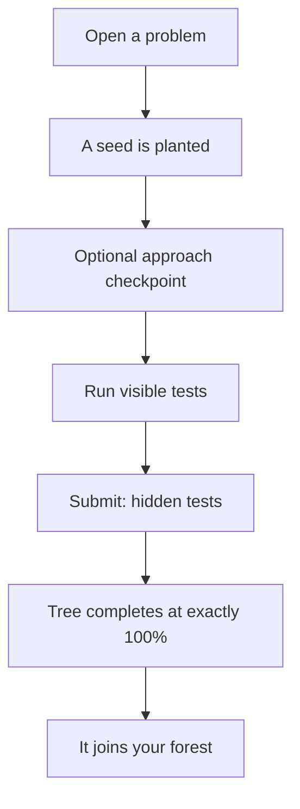

# voxelcode
Practice coding problems where **every problem grows a voxel tree**.


## Table of Contents
- [What is voxelcode?](#what-is-voxelcode)
- [How it works](#how-it-works)
- [Installation](#installation)
    - [Run it locally](#run-it-locally)
    - [Run it with Docker](#run-it-with-docker)
- [The core loop](#the-core-loop)
- [Trees and seasons](#trees-and-seasons)
- [Languages](#languages)
- [Add your own problem](#add-your-own-problem)
- [Add a new tree species](#add-a-new-tree-species)
- [Architecture](#architecture)
- [Sandbox and privacy](#sandbox-and-privacy)
- [Your TODO: the oak](#your-todo-the-oak)
- [Future improvements](#future-improvements)

## What is voxelcode?
It is a coding practice site in the spirit of NeetCode, but every problem you open plants a seed.
- Pass tests and a procedural voxel tree grows beside your code
- Finish the problem and the tree takes root in a persistent 3D forest
- Everything is **local-first**: your progress lives in your browser (IndexedDB), with no accounts, no backend and no telemetry
- All problem statements, examples and editorials are **original writing**
- All art is **procedural**: every tree, the ground and every icon is generated from code
> [!NOTE]
> Because progress is stored in the browser, anyone who visits a hosted copy gets their own empty forest.

## How it works


## Installation
> [!IMPORTANT]
> There are **two** ways to run voxelcode: locally with Node, or in a Docker container.

### Run it locally
You need Node 20.9 or newer (the Docker image uses Node 22).
```bash
git clone https://github.com/ayaans16/voxelcode
cd voxelcode
npm install     # also copies Monaco and Pyodide into /public and bundles the workers
npm run dev     # http://localhost:3000
```
> [!WARNING]
> If port `3000` is busy, Next.js quietly picks the next free one (like `3001`). Check the URL it prints.

<details>
  <summary><b>All the scripts</b></summary>

| Script | What it does |
| --- | --- |
| `npm run dev` | Dev server, plus a watcher that rebuilds the workers |
| `npm test` | Vitest: engine, runner, storage, and every problem's reference solution |
| `npm run typecheck` | `tsc --noEmit` |
| `npm run lint` | ESLint |
| `npm run e2e` | Playwright happy paths (builds and serves the production app) |
| `npm run build` | Production build |

</details>

### Run it with Docker
```bash
docker build -t voxelcode .
docker run -p 3000:3000 voxelcode
```
Then open http://localhost:3000.
> [!CAUTION]
> The Docker image turns the Java, C and Go compile server **off** (`VOXELCODE_NATIVE_RUNNER=off`). Those languages run arbitrary programs, so they are only meant for your own machine. See [Languages](#languages).

## The core loop
1. **Open** a problem: a seed is planted (+5%)
2. **Approach checkpoint** (optional): pick the pattern and the time/space complexity. Correct is +15%, wrong is +8% (and you see the right answer and why). Only your first answer counts
3. **Run** the visible tests: up to +35%, proportional to how many pass
4. **Submit** to run the hidden tests. They fill the rest of the bar, so a full pass always lands on exactly 100% and the tree completes with a cascade of leaves
5. Solved problems become trees in the **forest**

> [!TIP]
> Growth only ever goes forward. Failures never shrink a tree, and hints only reduce the golden-leaf bonus. Nothing dies.

Cosmetic bonuses never change growth: golden leaves for a first-try full pass, extra blossoms for solving faster than your own median, and streaks that shift leaves toward autumn gold.

## Trees and seasons
The pattern a problem teaches decides which tree it grows.

| Pattern | Tree |
| --- | --- |
| two pointers, bit tricks | bamboo |
| sliding window | willow |
| binary search | tiered pine |
| trees | oak |
| graphs, backtracking | banyan |
| dynamic programming | weeping willow |
| hashing | cherry blossom |
| stack, heap | cypress |
| anything else | oak |

Pick a **season** (or leave it on auto, which follows the calendar) and every tree changes colors: pink spring leaves, summer green, autumn reds and golds, and snowy winter branches. Seasons only change colors, never the shape of a tree.

## Languages
| Language | Where it runs |
| --- | --- |
| JavaScript | In your browser, in a Web Worker |
| Python | In your browser, on Pyodide |
| Java, C, Go | On a local compile server, using the toolchains installed on your machine |

JavaScript and Python have a hard timeout (the main thread terminates the worker), no DOM and no network.

<details>
  <summary><b>Java, C and Go (local compile server)</b></summary>

These cannot run in a browser worker, so `app/api/run` compiles and runs them with `javac`/`java`, `cc`/`clang`/`gcc` and `go`. The language picker greys out any that are missing.

- **Conventions.** Java: `class Solution` with a `public static` method. Go: `package main` and a lowercase function, with no `main`. C: arrays arrive as pointer plus length, and you return arrays with `malloc` and an out-parameter. Each starter shows the exact signature.
- **How it works.** A driver is generated from the problem signature, values travel as simple tokens, and results stream back as they finish. Hidden tests live on the server so they never reach the browser.

> [!CAUTION]
> This is **not a security sandbox**. Your code runs as a normal process of whoever runs voxelcode. The endpoint only accepts same-origin JSON requests to `localhost`, so other websites and machines cannot use it. Set `VOXELCODE_NATIVE_RUNNER=off` to disable it, and never expose it on a public server.

</details>

## Add your own problem
1. Copy [`src/problems/data/_template.ts`](src/problems/data/_template.ts) to `src/problems/data/<your-slug>.ts` and fill it in (the template explains every field)
2. Register it with an `import` and an entry in [`src/problems/index.ts`](src/problems/index.ts)
3. Run `npm test`. It checks the schema and runs your reference solution (JavaScript **and** Python) against every test, so a wrong expected value fails right away

> [!TIP]
> - Write the statement, examples, hints and editorial yourself. Classic ideas are fine, copied wording is not
> - Hidden tests need the categories `basic`, `edge` and `large`
> - The first entry in `patterns` picks the tree species

## Add a new tree species
Add an entry to `SPECIES` in [`src/engine/species.ts`](src/engine/species.ts) with a name, the `patterns` that map to it, sizes per difficulty, a palette and a `generate` function (the helpers in `src/engine/generators/kit.ts` do the heavy lifting). The generic tests check determinism, no floating voxels, growth order and size bounds for it automatically.

## Architecture
```
src/
  engine/      pure: seeded PRNG, species, tree generation, progress math, seasons
  render/      three.js (InstancedMesh): trees, forest, ground, day/night, falling leaves
  runner/      worker protocol, test harness, Pyodide bridge, native (Java/C/Go) runner
  problems/    zod schema and one data file per problem
  storage/     Storage interface, IndexedDB and in-memory versions, migrations
  components/  UI
app/           Next.js routes: /, /problems, /problems/[slug], /forest, /settings
```
<details>
  <summary><b>Key design choices</b></summary>

- **The whole tree is generated up front.** `generateTree({ seed, species, difficulty })` returns every voxel in order of appearance, and the visible tree is just the first `floor(progress * N)` of them. Growth is monotonic and reproducible, and every voxel touches an earlier one.
- **Progress ratchets.** Each source keeps the best value ever reached, so retrying with worse code never lowers anything.
- **Workers are built separately.** `scripts/build-workers.mjs` bundles them as real ES-module workers, because Pyodide refuses to run in classic ones.
- **Storage sits behind an interface.** Swap `IdbStorage` for a server-backed class in `src/storage/index.ts` later. Saved data is versioned and migrated.

</details>

## Sandbox and privacy
- JavaScript and Python run with no DOM, network APIs removed, and (in production) a CSP of `connect-src 'self'`
- Infinite loops are killed after the time limit
- This protects your machine, not the integrity of the problem set. A determined user could print the tests, which is fine for a personal practice tool
- Nothing leaves your browser. Export and import your data as JSON from the Forest page

## Your TODO: the oak
[`src/engine/generators/oak.ts`](src/engine/generators/oak.ts) holds a deliberately plain placeholder (a trunk with a blob on top). Write the real branch-splitting and voxel-ordering algorithm, set `OAK_IMPLEMENTED = true`, and make the acceptance tests in [`oak.test.ts`](src/engine/generators/oak.test.ts) pass. Use the playground at `/dev/tree` to watch it grow while you work.

## Future improvements
> [!TIP]
> - [x] Seasonal tree themes
> - [x] Java, C and Go support
> - [ ] Run Java, C and Go for visitors of a hosted copy (needs a separate sandboxed runner)
> - [ ] Spaced-repetition "wants water" trees
> - [ ] Daily challenge and cosmetic unlocks
> - [ ] Accounts and a shared grove
> - [ ] A step-through visualizer
