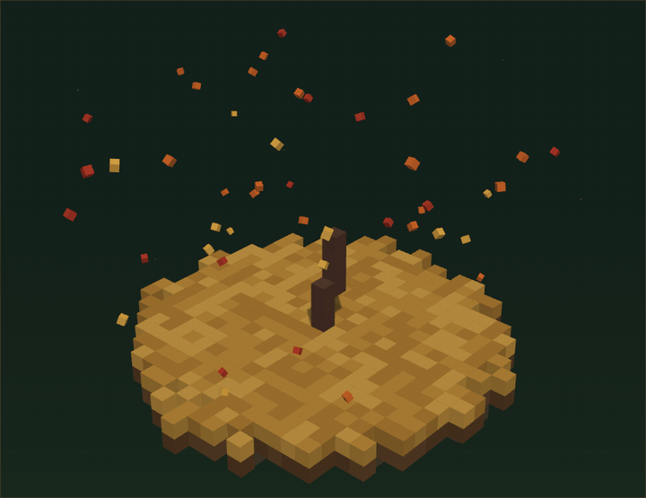

# voxelcode

Practice coding problems. **Every problem grows a voxel tree.**

Open a problem and a seed is planted. Pass tests and the tree grows. Finish the problem and the tree joins a persistent 3D forest.

<!-- TODO: replace with a screen recording (record /problems/budget-pair solving to completion, then the forest). -->


- **Local-first.** Progress lives in your browser (IndexedDB). No accounts, no backend, no telemetry.
- **Original problems.** All statements, examples and editorials are written for this project.
- **Procedural art only.** Every tree, the ground and every icon is generated from code. UI fonts are bundled (JetBrains Mono, Silkscreen).
- **Five languages.** JavaScript and Python run in your browser in a Web Worker with a hard timeout, no DOM and no network (Python on Pyodide). **Java, C and Go** are compiled and run by a local server using the JDK, C compiler and Go toolchain on your machine (see below).

## Quick start

```bash
npm install     # also copies Monaco and Pyodide into /public and bundles the workers
npm run dev     # http://localhost:3000
```

| Script | What it does |
| --- | --- |
| `npm test` | Vitest: engine, runner, storage, and every problem's reference solution (JS and Python) |
| `npm run typecheck` / `npm run lint` | `tsc --noEmit` / ESLint |
| `npm run e2e` | Playwright happy paths (builds and serves the production app) |
| `npm run build` | Production build |

## The core loop

1. **Open** a problem: a seed is planted (+5%).
2. **Approach checkpoint** (optional): pick the pattern and the time/space complexity. Correct = +15%, wrong = +8% (and you see the right answer and why). Learning is rewarded either way. Only the first answer counts.
3. **Run** the visible tests: up to +35%, proportional to the fraction passing.
4. **Submit**: runs the hidden tests. Hidden tests fill the *rest* of the bar, so a full pass always lands on exactly 100% and the tree completes with a cascade and a puff of leaves. Failures only name the failing category ("edge cases", "large inputs", "time limit") and never shrink anything.
5. Solved problems become trees in the **forest**.

Cosmetic bonuses never change growth: golden leaves for a first-try full pass (each hint used removes part of them), extra blossoms for solving faster than your own median for that difficulty. Streaks shift leaves toward autumn gold; a broken streak just goes back to green. Nothing dies.

## Architecture

```
src/
  engine/    PURE. seeded PRNG, species, tree generation, progress math, sessions, stats. No DOM / three.
  render/    three.js (InstancedMesh): TreeMesh, VoxelScene, ForestScene, ground, day/night, seasons
  runner/    protocol (zod), harness, comparison modes, Pyodide bridge, RunnerClient (hard timeouts), workers
  problems/  schema (zod), define helpers, data/*.ts (one file per problem), registry
  storage/   Storage interface + IndexedDB + in-memory implementations + migrations
  components/ UI
app/         Next.js routes: /, /problems, /problems/[slug], /forest, /settings
scripts/     copy-assets (Monaco, Pyodide), build-workers (esbuild)
```

**Key design choices**

- *The whole tree is generated up front.* `generateTree({ seed, species, difficulty })` returns every voxel in order of appearance (trunk, then branches, then leaves). The visible tree is just the first `floor(progress * N)` voxels, so growth is monotonic, reproducible and trivially animatable. Each voxel is guaranteed to touch an earlier one (no floating voxels): the `Builder` refuses to add one that doesn't.
- *Progress ratchets.* Each source tracks the best fraction ever reached, so retrying with worse code can't lower anything.
- *Workers are built separately.* `scripts/build-workers.mjs` bundles `js.worker` and `py.worker` into `public/workers/` as real ES-module workers, because Pyodide refuses to run in the "classic" workers the app bundler emits.
- *The main thread owns timeouts.* A worker in an infinite loop can't answer, so `RunnerClient` terminates it, marks the test "Time limit exceeded", and carries on with the remaining tests in a fresh worker.
- *Storage sits behind an interface.* Swap `IdbStorage` for a server-backed class in `src/storage/index.ts` later. Persisted data is versioned (`schemaVersion`) with a migration path and zod-validated imports.

### Runner message protocol

```
main -> worker   init | run { runId, language, code, functionName, tests[], comparison, timeLimitMs }
worker -> main   ready | testStart | testResult | done | fatal { syntax | missing_function | internal }
```

## How to add a problem

1. Copy [`src/problems/data/_template.ts`](src/problems/data/_template.ts) to `src/problems/data/<your-slug>.ts` and fill it in (the template explains every field).
2. Register it: add an `import` and an entry in [`src/problems/index.ts`](src/problems/index.ts). The order there is the order in each roadmap section.
3. Run `npm test`. The suite validates the schema and runs your `referenceSolution` (JavaScript **and** Python) against every visible and hidden test, so a wrong expected value fails immediately.

Rules of thumb:

- Write the statement, examples, hints and editorial yourself. Classic *ideas* are fine; copied wording is not.
- Hidden tests need categories `basic`, `edge` and `large`. The `large` ones are what make brute force time out.
- The **first** entry in `patterns` picks the tree species (see below) and groups the problem on the roadmap.
- Build big inputs with plain code at the top of the file and compute their expected values with a small TypeScript reference function in the same file.

## How to add a species

Add an entry to `SPECIES` in [`src/engine/species.ts`](src/engine/species.ts): name, which `patterns` map to it, `dims` per difficulty, a palette, and a `generate` function (use the helpers in `src/engine/generators/kit.ts`). The generic tests in `generate.test.ts` immediately check determinism, no floating voxels, phase order and size bounds for it.

| Pattern | Species |
| --- | --- |
| two pointers, bit tricks | bamboo |
| sliding window | willow |
| binary search | tall tiered pine |
| trees / graphs, backtracking | oak / banyan |
| dynamic programming | weeping willow |
| hashing | cherry blossom |
| stack, heap | cypress |
| anything else | oak |

## Your TODO: the oak

[`src/engine/generators/oak.ts`](src/engine/generators/oak.ts) holds a deliberately plain placeholder (a trunk with a blob on top). Implement the real branch-splitting and voxel-ordering algorithm, set `OAK_IMPLEMENTED = true`, and make the acceptance tests in [`oak.test.ts`](src/engine/generators/oak.test.ts) pass. The contract is documented at the top of `oak.ts`. Use the playground at `/dev/tree` to see it while you work.

## Java, C and Go (local compile server)

These languages cannot run in a browser worker, so `app/api/run` compiles and runs them with the toolchains installed on the machine that runs voxelcode (`javac`/`java`, `cc`/`clang`/`gcc`, `go`). The language picker greys out any that are missing (`GET /api/runtimes`).

- **Conventions.** Java: `class Solution` with a `public static` method. Go: `package main` and a lowercase function; do not define `main`. C: arrays arrive as pointer + length; return arrays by `malloc` and an out-parameter (`returnSize`, and `returnColumnSizes` for 2D). Each language's starter code shows the exact signature for the problem.
- **How it works.** A driver is generated from the problem signature, values travel as simple tokens (`src/runner/native/encoding.ts`), the server streams results back as NDJSON, and hidden tests are looked up by slug on the server so they never reach the browser. The server owns the time limits: a runaway process is killed and the remaining tests continue in a fresh process.
- **Trust model (read this).** This is **not a security sandbox**. Your code runs as a normal process of the user running voxelcode, with a timeout, a temp working directory and a minimal environment, but it can read files and use the network. Only run code you wrote. The endpoint refuses anything that is not a same-origin JSON request addressed to `localhost`/`127.0.0.1`, so other websites and other machines on your network cannot use it. Set `VOXELCODE_NATIVE_RUNNER=off` to disable it entirely. Do not deploy this app to a public server with the compile server enabled.
- **Adding reference solutions.** `referenceSolution.java`, `.c` and `.go` are optional per problem; when present, `npm test` compiles and runs them against every test (skipped automatically when a toolchain is missing).

## Sandbox and privacy

- JavaScript and Python run in a Web Worker: no DOM. Network APIs (`fetch`, `XMLHttpRequest`, `WebSocket`, ...) are removed before user code runs, and the production build sets a CSP with `connect-src 'self'`.
- Infinite loops are killed by the main thread after the time limit.
- This protects your machine, not the integrity of the problem set (a determined user can print the tests). That's fine for a personal practice tool.
- Nothing leaves your browser. Export/import your data as JSON from the Forest page.

## Not built yet (stretch goals)

Spaced-repetition "wants water" trees, daily challenge and cosmetic unlocks, server-side judging (Judge0/Piston), accounts and a shared grove, and a step-through visualizer.
